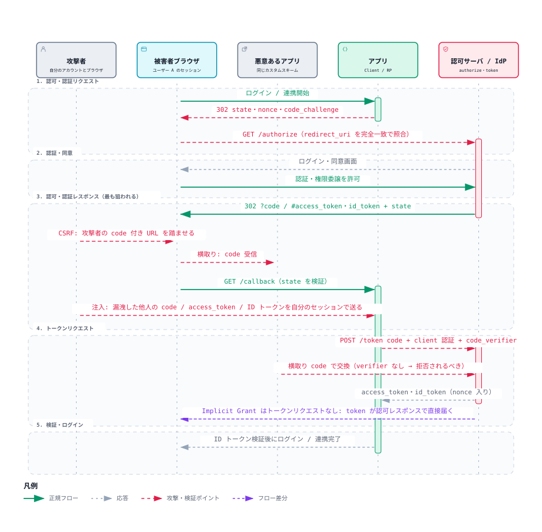

# OAuth の認可コードフローの診断観点

> OAuth の診断の経験がある人へ。観点表との差分になりやすいのは次の 5 点で、必要な節だけ拾えるようにしてある。持ち帰るチェックリストは [7 節](#checklist)。
>
> | 差分になりやすい点 | 節 |
> |---|---|
> | state を検証していても、認可コードの注入は止まらない | 3 |
> | PKCE だけで CSRF を防ぐクライアントは、認可サーバが PKCE ダウングレードを止めていないと CSRF が通る | 4 |
> | code の再利用は、2 回目の拒否だけでなく、1 回目のトークンの失効まで見る | 4 |
> | Referer での漏えいは、Referrer Policy を既定より緩めたページや要素で起きる。外部の JavaScript は Referer を介さず URL を読む | 5 |
> | mix-up 攻撃では、ログイン失敗の画面でも code が漏えいしうる。画面ではなく通信で判定する | 5 |
>
> どれも [7 節のチェックリスト](#checklist) の 1 行になっている。

> 想定読者：Web アプリケーションの脆弱性診断ができ、OAuth / OIDC の認可コードフローと、PKCE や nonce などの対策を知っているが、その診断観点を知らない人。上の表は経験者が必要な節だけ拾うための入口で、初めての人はここから順に読む。HTTP、302 リダイレクト、Cookie のセッション、CSRF、セッション固定、オープンリダイレクト、プロキシでの書き換えと再送は知っている前提にした。
>
> 省いたもの：OAuth の歴史とグラントの網羅、JWT の構造、Hybrid Flow の詳細、ネイティブアプリ固有の横取り、PAR、リフレッシュトークン。リソースサーバ側の観点（盗まれたアクセストークンの送信者制約・受信者制約、DPoP、`sub` にクライアント ID が入るなりすまし）は、Hideki Ikeda 氏の [攻撃手法から学ぶ OAuth セキュリティベストプラクティス](https://zenn.dev/hidebike712/books/oauth-attacks-and-bcp)（v1.2.3、以下「Zenn の本」）の 9・12〜14 章にある。
>
> 所要時間：20 分。
>
> 検証方法：攻撃と対策の結果は、認可サーバとクライアントを関数で書いた再現スクリプト `examples/flow.mjs` を実行した出力を貼った。RFC・OpenID Connect Core 1.0 の要件と Zenn の本の記述は、`sources/` に保存した原文から 1 文ずつ取り出して貼り、`checks.json` で照合した。図と診断観点の並びは、archify で作った OAuth・OIDC の攻撃点の図（1 節）と、Zenn の本をもとにした。

認可コードフローの診断では、どの値が何と何を紐付けているかを押さえ、その値を外したり差し替えたりしたリクエストを送って、通るかどうかを見る。
見る値は redirect_uri・state・PKCE（code_verifier）・iss の 4 つで、照合する側が値ごとに決まっている。
照合する側を取り違えると、試すリクエストの送り先を間違え、通った結果を誰の不備として報告するかも間違える。

読み終えたら、次の 3 つを判定できるようにする。

1. 認可コードフローのどのリクエストの、どの値を書き換えればよいか
2. 書き換えたリクエストが通ったとき、それは認可サーバとクライアントのどちらの不備か
3. 通っても脆弱ではない挙動、通らなくても安心できない挙動はどれか

<details><summary>節ごとの役割</summary>

| 節 | 役割 | 見せるもの | なぜ |
|---|---|---|---|
| 0 | 書き換える値と、照合する側を 1 枚に | 表 | 本文を読まずに持ち帰れるように |
| 1 | 段階ごとに読み取る知識とゴール | archify の図と表 | 書き換えるリクエストの位置と、各節で何ができるようになるかを先に示すため |
| 2 | redirect_uri は認可サーバが完全一致で照合する | `flow.mjs` の出力 | ワイルドカードの突破と、ループバックの誤検知を判定するため |
| 3 | state と PKCE は防ぐ攻撃が違う | `flow.mjs` の出力 | state があっても認可コードの注入は通るため |
| 4 | トークンエンドポイントで試すこと | `flow.mjs` の出力 | 認可サーバ側の不備を、クライアントから切り分けるため |
| 5 | code の漏えいと mix-up 攻撃 | 原文と `flow.mjs` の出力 | 注入の前提になる漏えいと、複数の認可サーバの構成を診断に入れるため |
| 6 | Implicit Grant と OIDC | 原文 | 見つけたら指摘する構成と、ID トークンで足す観点を押さえるため |

</details>

## 0. 一枚で

登場人物は 3 つ。
利用者のブラウザ、診断対象のアプリ（クライアント。OIDC では RP とも呼ぶ）、ログインを担う認可サーバ（OIDC では IdP や OP とも呼ぶ）。
クライアントはブラウザを認可サーバへ 302 で送り、認可サーバはログインと同意の後、ブラウザをクライアントの `/callback` へ認可コード（code）付きで 302 で戻す。
クライアントはその code を、裏で認可サーバのトークンエンドポイントへ送り、アクセストークンと交換する。
「Google でログイン」のように外部の IdP を使うアプリでは、認可サーバは診断を依頼した組織のものではない。下の表で照合する側が認可サーバの行を試してよいかは診断の範囲の取り決めしだいで、通ったら IdP の不備として分けて報告する（4 節）。

| 書き換えるもの | 何を紐付けているか | 通ったら | 照合する側（根拠） |
|---|---|---|---|
| `/authorize` の `redirect_uri` を、登録値の前方一致・ワイルドカード・パス違いに | 登録した URI ↔ code を届ける先 | 攻撃者の URL や、オープンリダイレクタ経由で code が漏えいする | 認可サーバ（[RFC 9700 §2.1](https://www.rfc-editor.org/rfc/rfc9700#section-2.1)、[§4.1](https://www.rfc-editor.org/rfc/rfc9700#section-4.1)） |
| `/callback` の `state` を、削除・別セッションの値に（state で CSRF を防ぐクライアント） | フローを始めたセッション ↔ code を受け取るセッション | 被害者が攻撃者のアカウントでログイン・連携する（CSRF） | クライアント（[RFC 9700 §2.1](https://www.rfc-editor.org/rfc/rfc9700#section-2.1)、[§4.7](https://www.rfc-editor.org/rfc/rfc9700#section-4.7)） |
| `/callback` の `code` を、別のブラウザで得た code に（state は自分の値） | 認可リクエスト ↔ トークンリクエスト（PKCE） | 攻撃者のセッションが被害者として扱われる（認可コードの注入） | PKCE なら認可サーバ、nonce（confidential な OIDC クライアントに限る）ならクライアント。どちらも使っていなければクライアントの不備。PKCE を使っていて通ったら、先にクライアントが code_verifier をフローごとに作っているかを確かめる（3 節）（[RFC 9700 §2.1.1](https://www.rfc-editor.org/rfc/rfc9700#section-2.1.1)、[§4.5](https://www.rfc-editor.org/rfc/rfc9700#section-4.5)） |
| 自分の `/authorize` から `code_challenge` を外し、その code を被害者に踏ませる | 同上 | PKCE だけで CSRF を防ぐクライアントで、CSRF が通る（PKCE ダウングレード） | 認可サーバ（[RFC 9700 §2.1.1](https://www.rfc-editor.org/rfc/rfc9700#section-2.1.1)、[§4.8](https://www.rfc-editor.org/rfc/rfc9700#section-4.8)） |
| `/token` で同じ `code` を 2 回交換、`redirect_uri` を変えて交換 | code ↔ client・redirect_uri | 漏えいした code が使える | 認可サーバ（[RFC 6749 §4.1.2](https://www.rfc-editor.org/rfc/rfc6749#section-4.1.2)、[§4.1.3](https://www.rfc-editor.org/rfc/rfc6749#section-4.1.3)） |
| `/callback` の `iss` を、別の認可サーバの値に（iss パラメータで mix-up 攻撃を防ぐクライアント） | 要求を送った認可サーバ ↔ 応答を返した認可サーバ | mix-up 攻撃を防げない（攻撃が成立すると code が攻撃者の認可サーバへ送られる） | クライアント（[RFC 9700 §2.1](https://www.rfc-editor.org/rfc/rfc9700#section-2.1)、[RFC 9207 §2.4](https://www.rfc-editor.org/rfc/rfc9207#section-2.4)） |

通っても脆弱でない挙動が 1 つある。
ネイティブアプリのループバック IP（`http://127.0.0.1` や `http://[::1]`）の redirect URI でポートだけが違う要求を、認可サーバが受理するのは正しい（2 節）。

**state を検証していても、認可コードの注入は止まらない。**
攻撃者は自分のセッションで取った state を使うので、state の照合は通る。注入を止めるのは PKCE か OIDC の nonce で、PKCE は認可サーバのトークンエンドポイントが、nonce はクライアントが照合する（3 節）。
逆に、PKCE だけで CSRF を防ぐクライアントは、認可サーバが PKCE ダウングレードを止めていなければ CSRF が通る（4 節）。

## 1. 段階ごとに読み取る知識とゴール

図は archify（図を HTML で描くツール）で描いた認可コードフローのシーケンス図。横の帯が 5 つの段階で、緑の実線が正規のフロー、赤の破線が攻撃と検証の位置を表す。



段階ごとに、読み取る知識と、その節を読み終えたときのゴールは次のとおり。ゴールの確認には 7 節のチェックリストを使う。

| 段階 | 読み取る知識 | ゴール | 節 |
|---|---|---|---|
| 1. 認可リクエスト | `redirect_uri` を照合するのは認可サーバで、照合が緩いと code が登録外の URL へ届く | `redirect_uri` の照合が完全一致かを判定でき、ループバックのポート違いを誤検知しない | 2 |
| 2. 認証・同意 | ログイン済みや自動承認なら、同意画面を経ずに認可レスポンスまで進む | 以降の段階の脆弱性の確認リクエストで、利用者の操作が要らない前提を置ける | — |
| 3. 認可レスポンス | code はブラウザの URL で届くので、書き換えられ、漏えいしうる。`state` と `iss` を照合するのはクライアント | state・iss の照合と code の漏えい経路について、どこで止まれば正しく、止まらなければクライアントの不備かを判定できる | 3・5 |
| 4. トークンリクエスト | ブラウザを通らない裏の通信で、code が誰のものかを PKCE で確かめるのは認可サーバ | トークンエンドポイントの結果を、クライアントではなく認可サーバの不備として切り分けて報告できる | 3・4 |
| 5. 検証・ログイン | OIDC では、ID トークンの nonce をクライアントが照合する | ID トークンの `iss`・`aud`・`exp` と、送った場合の `nonce` の検証は必須で、署名の検証はトークンエンドポイントから受け取った ID トークンなら TLS のサーバー検証で代えてよい、と区別できる | 6 |

攻撃者が被害者に踏ませる URL は 2 つ。

| 踏ませる URL | 狙い | 攻撃 |
|---|---|---|
| 1 の認可リクエスト | 被害者の code を奪う | redirect_uri の緩い照合、mix-up 攻撃 |
| 3 のコールバック | 攻撃者の code を被害者に入れる | CSRF、PKCE ダウングレード |

code は 3 でブラウザの URL に載るので、書き換えられ、Referer や履歴にも残る。

4 は裏の通信なので、届いた code が誰のものかは認可サーバが PKCE で確かめる（3 節）。

## 2. redirect_uri は認可サーバが完全一致で照合する

認可サーバは、認可リクエストの `redirect_uri` を、クライアントが事前に登録した URI と比べる。
前方一致やワイルドカードで比べると、攻撃者が用意した URL へ code が届く。

出典：[RFC 9700 §2.1](https://www.rfc-editor.org/rfc/rfc9700#section-2.1)

<!-- output: rfc-redirect -->
```
When comparing client redirection URIs against pre-registered URIs, authorization servers MUST utilize exact string matching except for port numbers in localhost redirection URIs of native apps (see Section 4.1.3).
Clients and authorization servers MUST NOT expose URLs that forward the user's browser to arbitrary URIs obtained from a query parameter (open redirectors) as described in Section 4.11.
```

再現スクリプト `examples/flow.mjs` では、認可サーバとクライアントを関数で書き、脆弱な設定と正しい設定に同じリクエストを送って結果を比べた。2〜5 節の結果の表はすべてこれの出力で、実物の挙動は、やられサーバなどを使って確かめる。

ここでは、登録値 `https://app.example/callback` に対して、前方一致（prefix）と完全一致（exact）の認可サーバに同じ要求を送った。
ワイルドカード（wildcard）の行は、Zenn の本の 2 章の例に合わせ、登録値を `https://*.app.example/callback` にして、`*` が `/` にも一致する認可サーバに送った。

出典：[Zenn の本 2 章](https://zenn.dev/hidebike712/books/oauth-attacks-and-bcp/viewer/insufficient-redirect-uri-validation)

<!-- output: zenn-wildcard -->
```
認可サーバーは、ワイルドカード * を「ドメイン名で有効な文字」ではなく、「/ を含む任意の文字列」として解釈する不適切なパターンマッチを実装しているものとします。
```

| 認可サーバの照合 | 登録値 | 送った redirect_uri | 判定 | 何が起きたか |
|---|---|---|---|---|
| 前方一致 | `https://app.example/callback` | `https://app.example/callback/../logout?next=…` | 脆弱 | 受理し、code が `/logout` に届く |
| 完全一致 | 同上 | 同上 | 安全 | 拒否 |
| 前方一致 | `https://app.example`（パスなし） | `https://app.example.example.jp/callback` | 脆弱 | 受理し、code が別のホストに届く |
| 部分一致（登録値を含むか） | `https://app.example/callback` | `https://attacker.example/?https://app.example/callback` | 脆弱 | 受理し、code が攻撃者のホストに届く |
| ワイルドカード（`*` が `/` にも一致） | `https://*.app.example/callback` | `https://attacker.example/.app.example/callback` | 脆弱 | 受理し、code が攻撃者のホストに届く |
| 完全一致 | `http://127.0.0.1/cb` | `http://127.0.0.1:51004/cb` | 安全 | 受理（ループバックのポート違いは許すのが正しい） |

<!-- output: flow -->
```
[prefix] https://app.example/callback/../logout?next=https://attacker.example → 受理 https://app.example/logout

[exact] https://app.example/callback/../logout?next=https://attacker.example → invalid_request（redirect_uri 不一致）

[prefix https://app.example] https://app.example.example.jp/callback → 受理 https://app.example.example.jp/callback

[contains https://app.example/callback] https://attacker.example/?https://app.example/callback → 受理 https://attacker.example/

[wildcard https://*.app.example/callback] https://attacker.example/.app.example/callback → 受理 https://attacker.example/.app.example/callback

[exact] http://127.0.0.1:51004/cb → 受理 http://127.0.0.1:51004/cb
```

前方一致では、`..` でクライアント内の別のページ（`/logout`）へ出る URI を受理した。登録値にパスがあれば、前方一致でもホストは変えられないが、登録外のページに code が届く。
登録値にパスが無いと、前方一致では `app.example.example.jp` のようにホスト名の後ろを伸ばした別のホストも通る。登録値を含むかで比べる認可サーバでは、クエリに登録値を入れるだけで任意の URL が通る。

そのページがオープンリダイレクタでも、302 の転送で引き継がれるのはフラグメントで、クエリの code は引き継がれない。認可サーバが `response_mode=fragment` を受け付けるなら、攻撃者はそれを付けて code をフラグメントで返させ、攻撃者のサイトまで運ばせられる。

出典：[RFC 9700 §4.1.2](https://www.rfc-editor.org/rfc/rfc9700#section-4.1.2)

<!-- output: rfc-fragment -->
```
Additionally, implicit grants (and also other grants when using response_mode=fragment as defined in [OAuth.Responses]) can be subject to a further kind of attack.
The attack utilizes the fact that user agents reattach fragments to the destination URL of a redirect if the location header does not contain a fragment (see Section 17.11 of [RFC9110]).
```

ワイルドカードでは、ホストが `attacker.example` の URI を受理した。登録値にワイルドカードがある認可サーバでは、`*` の位置に `/` を含む値を入れて試す。
試すときは、どの登録値とも一致しないように、サブドメイン・パス・クエリ・`..`・大文字小文字を変えた `redirect_uri` を送り、エラー画面になるか（認可サーバがクライアントへ戻さないか）を見る。

最後の行は、登録値 `http://127.0.0.1/cb` にポートを付けた要求で、受理するのが正しい。

出典：[RFC 8252 §7.3](https://www.rfc-editor.org/rfc/rfc8252#section-7.3)

<!-- output: rfc-loopback -->
```
The authorization server MUST allow any port to be specified at the time of the request for loopback IP redirect URIs, to accommodate clients that obtain an available ephemeral port from the operating system at the time of the request.
```

## 3. state と PKCE は防ぐ攻撃が違う

state はクライアントが生成してセッションに保存し、`/callback` で戻ってきた値と比べる。
PKCE は、クライアントが生成した秘密の `code_verifier` のハッシュ（`code_challenge`）を認可リクエストに載せ、トークンリクエストで `code_verifier` そのものを送る。認可サーバは、その code を発行したときの `code_challenge` と照合する。
どちらもクライアントのセッションに保存した値で、紐付けるものが違う。

1 つ目の攻撃は CSRF。攻撃者は自分のアカウントでフローを進め、`/callback` を踏まずに止めて、その URL を被害者に踏ませる。
被害者側は、自分でもログインや連携を始めて認可サーバから戻る前で止めた状態と、何も始めていない状態の両方で試す。PKCE だけで防ぐクライアントへの攻撃は、被害者のセッションに `code_verifier` が残っている前者で成り立つ。

| state の照合 | PKCE | 判定 | 何が起きたか |
|---|---|---|---|
| なし | なし | 脆弱 | 被害者のセッションが攻撃者としてログインする |
| なし | あり | 安全 | トークンエンドポイントで拒否（code_verifier 不一致） |
| あり | なし | 安全 | `/callback` で拒否（state 不一致） |

<!-- output: flow -->
```
[state検証=false PKCE=false] → ログイン成立：セッション victim-session が attacker として扱われる

[state検証=false PKCE=true] → トークン取得に失敗：invalid_grant（code_verifier 不一致）

[state検証=true PKCE=false] → state 不一致で拒否
```

state も PKCE も無いと、被害者のセッションが攻撃者のアカウントでログインした状態になる。連携機能なら、被害者のアカウントに攻撃者の外部アカウントが紐付き、被害者がアップロードしたファイルが攻撃者のストレージに保存される（Zenn の本の 7 章の被害例）。
PKCE だけでも、被害者のセッションの `code_verifier` が攻撃者の code と合わないので、トークンエンドポイントで止まる。RFC 9700 も、PKCE に対応した認可サーバなら PKCE で CSRF を防いでよいとしている。ただし 4 節の PKCE ダウングレードを止めている認可サーバに限る。

出典：[RFC 9700 §2.1](https://www.rfc-editor.org/rfc/rfc9700#section-2.1)

<!-- output: rfc-csrf -->
```
Clients that have ensured that the authorization server supports Proof Key for Code Exchange (PKCE) [RFC7636] MAY rely on the CSRF protection provided by PKCE.
In OpenID Connect flows, the nonce parameter provides CSRF protection.
Otherwise, one-time use CSRF tokens carried in the state parameter that are securely bound to the user agent MUST be used for CSRF protection (see Section 4.7.1).
```

state・nonce・code_verifier による防御は、どれもセッションを攻撃者が固定できないことが前提になる。ログイン開始のエンドポイントで、セッション固定もあわせて試す。

出典：[Zenn の本 7 章](https://zenn.dev/hidebike712/books/oauth-attacks-and-bcp/viewer/csrf) の脚注

<!-- output: zenn-session -->
```
本記事における「セッション」とは、攻撃者による推測や改竄ができない、セキュアに管理された状態を指します。
あらかじめ Session Fixation 攻撃などへの対策が講じられていることが前提となります。
```

2 つ目は認可コードの注入。攻撃者は被害者の code を何らかの方法で手に入れ（5 節）、自分のブラウザで正規のフローを始めて、戻ってきた認可レスポンスの code だけを差し替える。

出典：[RFC 9700 §4.5.1](https://www.rfc-editor.org/rfc/rfc9700#section-4.5.1)、[RFC 9700 §4.5.2](https://www.rfc-editor.org/rfc/rfc9700#section-4.5.2)、[RFC 9700 §2.1.1](https://www.rfc-editor.org/rfc/rfc9700#section-2.1.1)

<!-- output: rfc-injection -->
```
From the attacker's device, the attacker starts a regular OAuth authorization process with the legitimate client.
In the response of the authorization server to the legitimate client, the attacker replaces the newly created authorization code with the stolen authorization code.
Asymmetric methods for client authentication do not stop this attack, as the legitimate client authenticates at the token endpoint.
Public clients MUST use PKCE [RFC7636] to this end, as motivated in Section 4.5.3.1.
For confidential clients, the use of PKCE [RFC7636] is RECOMMENDED, as it provides strong protection against misuse and injection of authorization codes as described in Section 4.5.3.1.
```

再現スクリプトで、state を検証するクライアントに、被害者の code と攻撃者自身の state を送った。
後の 2 行は、client secret を持たないパブリッククライアント（SPA やネイティブアプリ）の code を、攻撃者がクライアントを通さず `/token` へ直接送った結果。

| クライアント | PKCE | 攻撃 | 判定 | 何が起きたか |
|---|---|---|---|---|
| state を照合する | なし | 被害者の code を攻撃者のセッションに注入 | 脆弱 | 攻撃者のセッションが被害者としてログインする |
| state を照合する | あり | 同上 | 安全 | トークンエンドポイントで拒否 |
| パブリッククライアント | なし | 攻撃者が `/token` を直接呼ぶ | 脆弱 | アクセストークンが発行される |
| パブリッククライアント | あり | 同上 | 安全 | 拒否（code_verifier 不一致） |

<!-- output: flow -->
```
[state検証=true PKCE=false] → ログイン成立：セッション attacker-session が victim として扱われる

[state検証=true PKCE=true] → トークン取得に失敗：invalid_grant（code_verifier 不一致）

[パブリッククライアント PKCE=false] 攻撃者が /token を直接呼ぶ → access_token 発行

[パブリッククライアント PKCE=true] 攻撃者が /token を直接呼ぶ → invalid_grant（code_verifier 不一致）
```

state の照合は通り、PKCE が無ければ攻撃者のセッションが被害者として扱われた。
引用の 3 文目のとおり、トークンリクエストを送るのは正規のクライアントなので、client secret などのクライアント認証も注入を止めない。
パブリッククライアントでは、漏えいした code はそのままアクセストークンになる。PKCE が MUST になっているのはこのため。

PKCE を使うクライアントで注入が通っても、すぐに認可サーバの不備とは決めない。クライアントが `code_verifier` をフロー間で使い回していれば、認可サーバが正しく照合しても通る。先に `code_verifier` がフローごとに変わるかを確かめる。
nonce で注入を防いでよいのは、confidential な OIDC クライアントに限られる。

出典：[RFC 9700 §2.1.1](https://www.rfc-editor.org/rfc/rfc9700#section-2.1.1)

<!-- output: rfc-pkce-binding -->
```
In any case, the PKCE challenge or OpenID Connect nonce MUST be transaction-specific and securely bound to the client and the user agent in which the transaction was started.
```

<!-- output: rfc-nonce-confidential -->
```
With additional precautions, described in Section 4.5.3.2, confidential OpenID Connect [OpenID.Core] clients MAY use the nonce parameter and the respective Claim in the ID Token instead.
```

出典：[RFC 9700 §4.5.3.2](https://www.rfc-editor.org/rfc/rfc9700#section-4.5.3.2)

<!-- output: rfc-public -->
```
It is important to note that nonce does not protect authorization codes of public clients, as an attacker does not need to execute an authorization code injection attack.
Instead, an attacker can directly call the token endpoint with the stolen authorization code.
```

診断では、自分の 2 つのブラウザ（A と B）で試す。A の認可レスポンスをプロキシで止め、クライアントに届く前に code を取り出す（届くと使用済みになる）。その code を B で始めたフローの認可レスポンスに差し替えて B の `/callback` へ送り、B が A のユーザーとしてログインすれば脆弱。

OIDC の nonce で注入を防ぐクライアントは、トークンレスポンスの ID トークンの nonce を照合しているかを見る。認可レスポンスにも ID トークンが入る構成（`response_type=code id_token`）で、そちらだけを照合していると、差し替えた code の ID トークンを見ていないことになる。
照合が済むまで、アクセストークンを使う処理（連携やプロフィールの取得）を始めていないかも見る。照合で拒否しても、その前に連携が済んでいれば注入は通っている（RFC 9700 §4.5.3.2 の 2 つ目の MUST）。

出典：[RFC 9700 §4.5.3.2](https://www.rfc-editor.org/rfc/rfc9700#section-4.5.3.2)

<!-- output: rfc-nonce -->
```
If an attacker injects an authorization code in the authorization response, the nonce value in the client session and the nonce value in the ID Token received from the token endpoint will not match, and the attack is detected.
```

PKCE を使うときは、`code_challenge_method` が `S256` であることも見る。`plain` は `code_verifier` をそのまま認可リクエストに載せるので、認可リクエストを読める攻撃者には効かない。

出典：[RFC 9700 §2.1.1](https://www.rfc-editor.org/rfc/rfc9700#section-2.1.1)

<!-- output: rfc-s256 -->
```
Currently, S256 is the only such method.
```

## 4. トークンエンドポイントで試すこと

この節の不備は、認可サーバの不備になる。
診断対象がクライアントだけで、認可サーバが外部の IdP なら、結果は IdP の不備として分けて報告する。

正常な交換が通ることを確かめた code は、それで使用済みになる。確認リクエストには毎回別の未使用の code を用意し、正常な要求から値を 1 つだけ変える。使用済みや期限切れの code、クライアント認証の失敗で拒否されても、目的の検証が効いた証拠にはならない。

1 つ目は PKCE ダウングレード。CSRF の一種で、PKCE を必須にしていない認可サーバと、CSRF 対策を PKCE だけに頼るクライアントの組み合わせで成り立つ。

出典：[RFC 9700 §4.8](https://www.rfc-editor.org/rfc/rfc9700#section-4.8)、[RFC 9700 §4.8.2](https://www.rfc-editor.org/rfc/rfc9700#section-4.8.2)、[RFC 9700 §2.1.1](https://www.rfc-editor.org/rfc/rfc9700#section-2.1.1)

<!-- output: rfc-downgrade -->
```
The first prerequisite for this attack is that there is an attacker-controllable flag in the authorization request that enables or disables PKCE for the particular flow.
The second prerequisite for this attack is that the client is not using state at all (e.g., because the client relies on PKCE for CSRF prevention) or that the client is not checking state correctly.
Using state properly would prevent this attack.
However, practice has shown that many OAuth clients do not use or check state properly.
Authorization servers MUST mitigate PKCE downgrade attacks by ensuring that a token request containing a code_verifier parameter is accepted only if a code_challenge parameter was present in the authorization request; see Section 4.8.2 for details.
```

攻撃者は自分のブラウザでフローを始め、クライアントが作った認可リクエストから `code_challenge` と `code_challenge_method` を外して送る。
認可サーバは PKCE に紐付かない code を発行する。攻撃者はその code 付きの `/callback` の URL を被害者に踏ませる。
クライアントは被害者のセッションの `code_verifier` を付けてトークンリクエストを送り、認可サーバは code に `code_challenge` が無いので照合を省く。

| 認可サーバ | 判定 | 何が起きたか |
|---|---|---|
| PKCE は任意で、ダウングレード対策なし | 脆弱 | 被害者のセッションが攻撃者としてログインする |
| PKCE は任意で、ダウングレード対策あり | 安全 | トークンエンドポイントで拒否 |
| PKCE 必須 | 安全 | 認可リクエストの時点で拒否 |

<!-- output: flow -->
```
[ダウングレード対策=false] → ログイン成立：セッション victim-session が attacker として扱われる

[ダウングレード対策=true] → トークン取得に失敗：invalid_grant（PKCE ダウングレード）

[PKCE 必須] → 認可リクエストで拒否：invalid_request（code_challenge が無い）
```

3 節の CSRF の 2 行目では PKCE が CSRF を止めたが、ダウングレード対策の無い認可サーバでは、同じクライアントで CSRF が通った。
試すときは、`code_challenge` を外した認可リクエストが拒否されるか（PKCE 必須）を見る。受理されたら、その code を `code_verifier` 付きで `/token` に送り、`invalid_grant` になるか（ダウングレード対策）を見る。どちらでもなければ、認可サーバの不備として報告し、クライアントが state を照合しているかも確かめる。

2 つ目は code の再利用と、トークンリクエストの `redirect_uri`。

出典：[RFC 6749 §4.1.2](https://www.rfc-editor.org/rfc/rfc6749#section-4.1.2)、[RFC 6749 §4.1.3](https://www.rfc-editor.org/rfc/rfc6749#section-4.1.3)

<!-- output: rfc-code-reuse -->
```
If an authorization code is used more than once, the authorization server MUST deny the request and SHOULD revoke (when possible) all tokens previously issued based on that authorization code.
parameter is present if the "redirect_uri" parameter was included in the initial authorization request as described in Section 4.1.1, and if included ensure that their values are identical.
```

| 確認リクエスト | 判定 | 何が起きたか |
|---|---|---|
| 1 回目の交換 | 正常遷移 | アクセストークンが発行される |
| 同じ code で 2 回目 | 安全 | 拒否 |
| 1 回目のアクセストークン | 安全 | 2 回目の交換で失効している |
| `redirect_uri` を `/callback2` に変えて交換 | 安全 | 拒否（認可リクエストと違う） |

<!-- output: flow -->
```
1 回目の交換 → access_token 発行

同じ code で 2 回目 → invalid_grant（code 再利用。発行済みトークンを失効）

1 回目の access_token → 失効

redirect_uri を /callback2 に変えて交換 → invalid_grant（redirect_uri が認可リクエストと違う）
```

2 回目の交換が拒否されるだけでは足りない。1 回目で得たアクセストークンが失効したかも、API を呼んで確かめる。失効は SHOULD（可能なら）なので、失効しなければ不備と断定せず、残るリスクとして書く。
code が漏えいして攻撃者が先に交換した場合、正規のクライアントの 2 回目の交換で、攻撃者のトークンを失効させられるため。
ほかに、`code_verifier` を省略・1 文字変えた要求と、別の `client_id` での交換も拒否されるかを見る。

3 つ目は code とトークンの推測。何回か認可を通して得た code やアクセストークンを並べ、桁数が少ない・連番に近いなど推測できそうなら、`/token` に code を総当たりで送り、制限で止まるかを見る。

出典：[RFC 6749 §10.10](https://www.rfc-editor.org/rfc/rfc6749#section-10.10)

<!-- output: rfc-guess -->
```
The probability of an attacker guessing generated tokens (and other credentials not intended for handling by end-users) MUST be less than or equal to 2^(-128) and SHOULD be less than or equal to 2^(-160).
```

## 5. code の漏えいと mix-up 攻撃

3 節の注入は、被害者の code が攻撃者の手に渡ることが前提。
code はクエリで `/callback` に届くので、そのページから外部のサイトへリクエストが出ると、Referer で外部へ送られうる。

出典：[RFC 9700 §4.2.4](https://www.rfc-editor.org/rfc/rfc9700#section-4.2.4)

<!-- output: rfc-referer -->
```
The page rendered as a result of the OAuth authorization response and the authorization endpoint SHOULD NOT include third-party resources or links to external sites.
```

ただし、現在のブラウザの既定の Referrer Policy では、別オリジンへの Referer にクエリは載らない。
漏えいするのは、`Referrer-Policy: unsafe-url` や `no-referrer-when-downgrade` のように既定を緩めたページに、外部リンクや外部リソースがあるとき。ページ全体が既定でも、`<a>` や `` の `referrerpolicy` 属性で要素ごとに緩められる。
外部の JavaScript を読み込むページでは、そのスクリプトが Referer を介さず `location.href` から code を読める。

出典：[Zenn の本 3 章](https://zenn.dev/hidebike712/books/oauth-attacks-and-bcp/viewer/credential-leakage-via-referer-headers)

<!-- output: zenn-referer -->
```
主要なモダンブラウザでデフォルトとなっている strict-origin-when-cross-origin では、cross-origin のリクエスト内の Referer ヘッダーに参照元 URL のパスやクエリは含まれないため、本攻撃は成立しない点に注意してください。
攻撃者が S_VIC を取得できてしまうと、state による CSRF 保護は失われ、攻撃者は CSRF を実行できる可能性があります。
```

診断では、クライアントの `/callback` とその転送先のページだけでなく、認可サーバの同意画面も見る。同意画面の URL には state が入るので、そこから漏えいすると 2 文目のとおり state が役に立たなくなる。
見るのは、レスポンスヘッダー・`<meta name="referrer">`・要素の `referrerpolicy` 属性の Referrer Policy、外部リンク・外部リソース・外部スクリプトの有無、アクセスログや解析ツールに code 付きの URL を残すかの 3 つ。

code はブラウザの履歴にも残る。端末を触れる攻撃者に対しては、4 節の code の 1 回限りと PKCE が効く。
アクセストークンを URL のクエリに載せて API を呼んでいたら、それ自体を指摘する。

出典：[RFC 9700 §4.3.2](https://www.rfc-editor.org/rfc/rfc9700#section-4.3.2)

<!-- output: rfc-history -->
```
Clients MUST NOT pass access tokens in a URI query parameter in the way described in Section 2.3 of [RFC6750].
```

`response_mode=form_post` を使うクライアントは、認可レスポンスが URL に載らないので、Referer と履歴からは漏えいしない。
その代わり、認可サーバからのクロスサイトの POST で `/callback` が呼ばれるので、セッション Cookie が `SameSite=Lax` だと送られない。

出典：[Zenn の本 4 章](https://zenn.dev/hidebike712/books/oauth-attacks-and-bcp/viewer/credential-leakage-via-browser-history) の脚注

<!-- output: zenn-samesite -->
```
コールバック処理が SameSite=Lax のセッション Cookie に依存している場合、その Cookie はこの POST では送信されず、ユーザーのセッションを復元できないために state の検証などに失敗する可能性があります。
```

form_post のクライアントでは、この制約のために state の照合が外されていないかを、3 節の state を改ざんした POST で確かめる。

認可サーバの mix-up 攻撃は、クライアントが複数の認可サーバ（「Google でログイン」と「GitHub でログイン」など）を使うときの攻撃。
被害者が攻撃者の認可サーバを選んで始めたフローを、攻撃者が正規の認可サーバへ転送すると、正規の認可サーバの code が「攻撃者の認可サーバの応答」としてクライアントに届く。
クライアントがそのまま攻撃者の認可サーバへトークンリクエストを送ると、code が攻撃者の手に渡る。

出典：[RFC 9700 §2.1](https://www.rfc-editor.org/rfc/rfc9700#section-2.1)

<!-- output: rfc-mixup -->
```
When an OAuth client can interact with more than one authorization server, a defense against mix-up attacks (see Section 4.4) is REQUIRED.
```

出典：[RFC 9207 §2.4](https://www.rfc-editor.org/rfc/rfc9207#section-2.4)

<!-- output: rfc-iss -->
```
If the value does not match the expected issuer identifier, clients MUST reject the authorization response and MUST NOT proceed with the authorization grant.
```

| クライアントの iss の照合 | 判定 | 何が起きたか |
|---|---|---|
| なし | 脆弱 | ログインは失敗するが、code が攻撃者の認可サーバに 1 個届く |
| あり | 安全 | iss 不一致で拒否し、code は届かない |

<!-- output: flow -->
```
[iss検証=false] → トークン取得に失敗：invalid_grant。攻撃者の認可サーバに届いた code 1 個

[iss検証=true] → iss 不一致で拒否（code を送らない）。攻撃者の認可サーバに届いた code 0 個
```

iss を見ないクライアントでは、ログインは失敗したが、code は攻撃者の認可サーバに届いた。利用者から見るとただのログイン失敗なので、画面の結果だけで判定しない。
iss はトークンリクエストの前に確かめる必要がある。トークンレスポンスの ID トークンの `iss` で確かめても、code はもう送った後になる。

iss を書き換える確認リクエストは、対策が効いているかを見るもので、攻撃の再現ではない。通常のフローで iss だけを書き換えても、クライアントはフローを始めた認可サーバへ code を送るので、code は漏えいしない。

まず、クライアントがどの対策を使っているかを確かめる。RFC 9700 が挙げるのは、iss パラメータ、ID トークンや JARM の iss、それらが使えないときの認可サーバごとの redirect URI。

出典：[RFC 9700 §2.1](https://www.rfc-editor.org/rfc/rfc9700#section-2.1)

<!-- output: rfc-mixup-options -->
```
use an alternative countermeasure based on an iss value in the authorization response (such as the iss claim in the ID Token in [OpenID.Core] or in [OpenID.JARM] responses), processing that value as described in [RFC9207].
In the absence of these options, clients MAY instead use distinct redirection URIs to identify authorization endpoints and token endpoints, as described in Section 4.4.2.
```

iss パラメータで防ぐクライアントには、`iss` を書き換える確認リクエストに加えて、`iss` を削除する確認リクエストも送る。認可サーバがメタデータで `iss` への対応を示しているなら、`iss` の無い応答もクライアントは拒否する。

出典：[RFC 9207 §2.4](https://www.rfc-editor.org/rfc/rfc9207#section-2.4)

<!-- output: rfc-iss-missing -->
```
Clients MUST reject authorization responses without the iss parameter from authorization servers that do support the parameter according to the client's configuration.
```

認可レスポンスに `iss` が無い認可サーバでは、認可サーバごとに redirect URI を分ける対策がある。
この対策を使うクライアントには、認可サーバ A で始めたフローの認可レスポンスを、B 用の redirect URI に送る。フローを始めた認可サーバの URI と応答を受けた URI が違うので、クライアントはトークンリクエストを送る前に止める。

出典：[RFC 9700 §4.4.2.2](https://www.rfc-editor.org/rfc/rfc9700#section-4.4.2.2)

<!-- output: rfc-mixup-redirect -->
```
Clients MUST check that the authorization response was received from the correct issuer by comparing the distinct redirection URI for the issuer to the URI where the authorization response was received on.
```

ただし、攻撃者が正規の認可サーバに自分のクライアントを登録し、その redirect URI に被害クライアントの別の認可サーバ用の URI を使えると、突破される。

出典：[Zenn の本 11 章](https://zenn.dev/hidebike712/books/oauth-attacks-and-bcp/viewer/mixup-attack)

<!-- output: zenn-mixup -->
```
攻撃者が H-AS に悪意のあるクライアント (クライアント ID = CID_EVIL) を登録し、そのクライアントが https://client.example.com/cb/a-as をリダイレクト URI として使用する場合、本対抗策は突破されてしまいます。
```

redirect URI を分けているだけのクライアントは、iss の照合を勧める。

## 6. Implicit Grant と OIDC

認可リクエストに `response_type=token`（Implicit Grant）を見つけたら、それ自体を指摘する。
アクセストークンが URL のフラグメントで直接届き、3 節の PKCE による紐付けが効かないため。

クライアントが `response_type=code` しか使っていなくても、認可リクエストを `token` に書き換えて送り、認可サーバがアクセストークンを返さないかも見る。返したら、そのクライアントの登録で Implicit Grant を許しているかを確かめる。許していないのに返したら認可サーバの不備、許しているなら使わない Implicit Grant を許した登録設定を指摘する。そのクライアントに Implicit Grant を許していなければ、認可サーバは `unauthorized_client` で拒否する。

出典：[RFC 6749 §4.2.2.1](https://www.rfc-editor.org/rfc/rfc6749#section-4.2.2.1)

<!-- output: rfc-unauthorized-client -->
```
The client is not authorized to request an access token using this method.
```

出典：[RFC 10017 §7.2](https://www.rfc-editor.org/rfc/rfc10017#section-7.2)

<!-- output: rfc-implicit -->
```
Browser-based clients MUST use the Authorization Code grant type and MUST NOT use the Implicit grant type to obtain access tokens.
```

既存の Implicit Grant を診断するときは、アクセストークンの注入を試す。攻撃者は自分のフローの認可レスポンスのアクセストークンだけを、被害者のものに差し替える。
アクセストークンでプロフィール API を呼び、その結果でログインさせるクライアントなら、攻撃者が被害者としてログインできる。3 節の code の注入と同じく、state では止まらない。

出典：[RFC 9700 §4.6](https://www.rfc-editor.org/rfc/rfc9700#section-4.6)、[§4.6.1](https://www.rfc-editor.org/rfc/rfc9700#section-4.6.1)

<!-- output: rfc-at-injection -->
```
Since the response includes the state value generated by the client for this particular transaction, the client does not treat the response as a CSRF attack and uses the access token injected by the attacker.
There is no way to detect such an injection attack in pure-OAuth flows since the token is issued without any binding to the transaction or the particular user agent.
In OpenID Connect, the attack can be mitigated, as the authorization response additionally contains an ID Token containing the at_hash claim.
```

OIDC の `response_type=id_token token` では、クライアントが ID トークンの `at_hash` とアクセストークンを照合しているかを、アクセストークンだけを差し替えて試す。
Implicit Flow では nonce の送信と照合が必須になる。

出典：[OpenID Connect Core 1.0 §3.2.2.10](https://openid.net/specs/openid-connect-core-1_0.html#ImplicitIDToken)

<!-- output: oidc-implicit-nonce -->
```
Use of the nonce Claim is REQUIRED for this flow.
```

出典：[OpenID Connect Core 1.0 §3.2.2.9](https://openid.net/specs/openid-connect-core-1_0.html#ImplicitTokenValidation)

<!-- output: oidc-at-hash -->
```
The value of at_hash in the ID Token MUST match the value produced in the previous step.
```

OIDC（`scope` に `openid` が入る）では、トークンレスポンスに ID トークンが加わり、認可リクエストの `nonce` が ID トークンに入って戻る。
クライアントが ID トークンで確かめる項目は、OpenID Connect Core 1.0 の §3.1.3.7 に並んでいる。

認可コードフローの ID トークンはトークンレスポンス（裏の通信）で届くので、ブラウザのプロキシでは書き換えられない。`iss`・`aud`・`exp`・`nonce` の検証は、各項目だけを変えた署名の正しい ID トークンを出せるテスト用の IdP を使うか、実装を読んで確かめる。ブラウザ経由で届く ID トークンは書き換えられるが、署名も壊れるので、拒否されてもどの項目で止まったかは分からない。

出典：[OpenID Connect Core 1.0 §3.1.3.7](https://openid.net/specs/openid-connect-core-1_0.html#IDTokenValidation)

<!-- output: oidc-idtoken -->
```
Clients MUST validate the ID Token in the Token Response in the following manner:
The Issuer Identifier for the OpenID Provider (which is typically obtained during Discovery) MUST exactly match the value of the iss (issuer) Claim.
The Client MUST validate that the aud (audience) Claim contains its client_id value registered at the Issuer identified by the iss (issuer) Claim as an audience.
If the ID Token is received via direct communication between the Client and the Token Endpoint (which it is in this flow), the TLS server validation MAY be used to validate the issuer in place of checking the token signature.
The Client MUST validate the signature of all other ID Tokens according to JWS
The current time MUST be before the time represented by the exp Claim.
If a nonce value was sent in the Authentication Request, a nonce Claim MUST be present and its value checked to verify that it is the same value as the one that was sent in the Authentication Request.
```

4 文目のとおり、トークンエンドポイントから直接受け取った ID トークンでは、署名の検証を TLS のサーバー検証で代えてよい（MAY）。認可コードフローのクライアントが署名を検証していなくても、それだけでは不備にしない。5 文目のとおり、それ以外の ID トークン（認可レスポンスなど、ブラウザを経由して届いたもの）は署名の検証が必須になる。

`aud` は、自分の client_id を含むだけでなく、信頼していない audience を含まないことも確かめる。

出典：[OpenID Connect Core 1.0 §3.1.3.7](https://openid.net/specs/openid-connect-core-1_0.html#IDTokenValidation)

<!-- output: oidc-aud -->
```
The ID Token MUST be rejected if the ID Token does not list the Client as a valid audience, or if it contains additional audiences not trusted by the Client.
```

nonce は 1 回限りの値なので、照合に使い終えた nonce をセッションから消しているかを、実装で確かめる。

出典：[RFC 9700 §4.5.3.2](https://www.rfc-editor.org/rfc/rfc9700#section-4.5.3.2)

<!-- output: rfc-nonce-once -->
```
The nonce value is one-time use and is created by the client.
```

<a id="checklist"></a>

## 7. チェックリスト

認可サーバに送るもの（認可サーバの不備）は次のとおり。

- [ ] どの登録値とも一致しないよう `redirect_uri` をサブドメイン・パス・クエリ・`..` 違い、ホスト名の後ろを伸ばしたもの、登録値をクエリに含めたものにした認可リクエストが、エラー画面で止まるか
- [ ] 登録値にワイルドカードがあれば、`*` の位置に `/` を含む値（`https://attacker.example/.app.example/callback`）を入れても止まるか
- [ ] ループバック IP の redirect URI でポートだけが違う要求は、受理されるのが正しい（報告しない）
- [ ] `code_challenge` を付けて取った code で、`code_verifier` を省略・改ざんしたトークンリクエストが拒否されるか
- [ ] `code_challenge` を外した認可リクエストが拒否されるか。受理されるなら、その code を `code_verifier` 付きで交換できないか
- [ ] 同じ code の 2 回目の交換が拒否されるか（MUST）。1 回目のアクセストークンも失効するか（SHOULD。失効しなければ残るリスクとして書く）
- [ ] 別の `client_id`、認可リクエストと違う `redirect_uri` での交換が拒否されるか。認可リクエストに `redirect_uri` を含めたなら、それを省いた交換も拒否されるか
- [ ] client secret などを持つクライアントの code を、クライアント認証を省いて、または誤った認証情報で交換できないか
- [ ] code・アクセストークンが推測できない値か。推測できそうなら、`/token` への code の総当たりが止まるか
- [ ] `response_type=code` のクライアントの認可リクエストを `token` に書き換えても、アクセストークンを返さないか（返したら、登録で許しているかを確かめる）
- [ ] 同意画面の Referrer Policy が既定より緩くないか、外部リンク・外部リソースが無いか

クライアントに送るもの（クライアントの不備）は次のとおり。

- [ ] 攻撃者のアカウントで得た code を被害者のブラウザの `/callback` に送り、アカウントの紐付けが起きないか（被害者側がフローを始めて完了前の状態と、始めていない状態の両方で）
- [ ] state で CSRF を防ぐクライアントなら、`/callback` の `state` を削除・改ざん・別セッションの値にしたとき、ログインや連携が完了しないか（PKCE や nonce で防ぐクライアントでは、通っても不備ではない。前の行で判定する）
- [ ] ログイン・連携の開始エンドポイントでセッションを固定できないか
- [ ] state・nonce・`code_verifier` がフローごとに新しく、推測できない値か（固定値や使い回しでないか）
- [ ] ブラウザ A でクライアントに届く前に取り出した code を、ブラウザ B のフローの認可レスポンスに差し替えて送り、B が A のユーザーにならないか（PKCE を使うクライアントでも試す）
- [ ] パブリッククライアントなら、認可リクエストに `code_challenge` を必ず付けているか。PKCE を使うなら `code_challenge_method=S256` か
- [ ] nonce で注入を防ぐなら、トークンレスポンスの ID トークンの nonce を照合し、照合が済むまでアクセストークンを使っていないか
- [ ] OIDC なら、ID トークンの `iss`・`aud`（自分の client_id を含み、信頼していない audience を含まないか）・`exp` と、認可コードフローで送った場合の `nonce` を検証しているか（テスト用の IdP か実装で確かめる）
- [ ] ID トークンの署名を検証していないなら、それが認可レスポンスで届いた ID トークンではないか（トークンエンドポイントから直接受け取った ID トークンでは、署名の検証を省いてよい）
- [ ] UserInfo を使うなら、その `sub` が ID トークンの `sub` と一致するかを照合しているか
- [ ] `/callback` とその転送先のページの Referrer Policy（ヘッダー・meta・要素の属性）が既定より緩くないか、外部リンク・外部リソース・外部スクリプトが無いか、ログに code を残さないか
- [ ] アクセストークンを URL のクエリに載せていないか
- [ ] 複数の認可サーバを使うなら、mix-up 攻撃の対策（iss パラメータ・ID トークンや JARM の iss・認可サーバごとの redirect URI）のどれを使っているか
- [ ] iss パラメータで防ぐなら、認可レスポンスの `iss` を別の値にしたとき、トークンリクエストを送らずに止まるか。認可サーバが `iss` に対応している（メタデータの `authorization_response_iss_parameter_supported`）なら、`iss` を削除しても止まるか
- [ ] 認可サーバごとの redirect URI で防ぐなら、認可サーバ A で始めたフローの認可レスポンスを B 用の redirect URI に送ったとき、トークンリクエストを送らずに止まるか
- [ ] `response_type` に `token` を含む要求（`token`、`id_token token`）を使っていないか。使っているなら、アクセストークンを差し替えて別のユーザーとしてログインできないか。OIDC なら nonce を必ず送り、ID トークンの nonce と `at_hash` を照合しているか

## 8. 理解度チェック

1. クライアントは state を正しく検証していて、PKCE は使っていない。認可コードの注入は試す必要があるか。

<details><summary>答え</summary>

試す必要がある。攻撃者は自分のブラウザで正規のフローを始め、そこで得た自分の state を使うので、state の照合は通る。3 節の 2 つ目の出力（`state検証=true PKCE=false` で被害者として扱われる）がこの形。止めるのは PKCE か OIDC の nonce。

</details>

2. ネイティブアプリの redirect URI が `http://127.0.0.1/cb` で登録されていて、`http://127.0.0.1:51004/cb` を送ると認可サーバが受理した。報告するか。

<details><summary>答え</summary>

報告しない。RFC 8252 §7.3 は、ループバック IP の redirect URI ではポートの違いを許すことを認可サーバに求めている（MUST）。2 節の最後の出力。パスやホストが違い、どの登録値とも一致しない要求が受理されたら、それは報告する。

</details>

3. code を同じまま 2 回トークンエンドポイントへ送ったら、2 回目は `invalid_grant` になった。これで「code の再利用対策は十分」と書いてよいか。

<details><summary>答え</summary>

まだ書かない。1 回目で得たアクセストークンが失効したかを、API を呼んで確かめる。RFC 6749 §4.1.2 は 2 回目の拒否を MUST、発行済みトークンの失効を SHOULD としている。失効しなければ、攻撃者が先に交換した場合のトークンが残る。4 節の出力の「1 回目の access_token → 失効」の行。

</details>

4. 「Google でログイン」と「独自の IdP でログイン」があるアプリで、認可レスポンスの `iss` を別の値にしたら、画面にはログイン失敗と出た。安全と判定してよいか。

<details><summary>答え</summary>

画面だけでは判定しない。ログインが失敗しても、クライアントが code を別の認可サーバのトークンエンドポイントへ送っていれば、code は漏えいしている。ログイン失敗には、トークンリクエストの前に止まった場合と、code を送った後に失敗した場合がある。5 節の攻撃の再現でも、iss を見ないクライアントはログインに失敗したが、攻撃者の認可サーバに code が 1 個届いた。クライアントの外向きの通信か実装で、トークンリクエストを送る前に止まったかを確かめる。

</details>

5. クライアントは state を使わず、PKCE（S256）を正しく実装している。CSRF は報告しなくてよいか。

<details><summary>答え</summary>

認可サーバしだいで決まる。RFC 9700 は、PKCE に対応した認可サーバなら PKCE で CSRF を防いでよいとしているが、認可サーバが PKCE ダウングレードを止めていなければ、攻撃者は `code_challenge` を外した自分の code を被害者に踏ませられる。4 節の出力の「ダウングレード対策=false」で被害者のセッションが攻撃者として扱われた行。`code_challenge` を外した認可リクエストと、その code の `code_verifier` 付きの交換を試し、どちらかで止まれば報告しない。

</details>

## 付録 再現手順

```sh
apm install                # yomiyasu を .claude/skills/ に入れる（日本語の点検に使う）
mise exec -- node examples/fetch-sources.mjs   # Zenn の本と OIDC Core 1.0 の本文を sources/ に取得する
mise exec -- node examples/flow.mjs
mise run verify            # 図の SVG を描き直すときは mise run verify --write=--write
```

`mise run verify` は、podman で `mcr.microsoft.com/playwright:v1.64.0-noble` を起動し、その中で `npm ci` と検証を実行する。explainer のスクリプトは `sh -c` にパスを渡すので、Windows では Linux のコンテナで実行する。node_modules は名前付きボリューム `explainer-oauth-node-modules` に置く。

| ファイル | 内容 |
|---|---|
| `examples/flow.mjs` | 認可サーバとクライアントを関数で書いた再現スクリプト。2〜5 節の出力はこれの実行結果 |
| `examples/rfc-quote.mjs` | `sources/` の RFC と Zenn の章から、指定した書き出しの 1 文を、改行と改ページをつないで取り出す |
| `sources/rfc*.txt` | 照合に使った RFC 6749・7636・8252・9126・9207・9700・10017 のテキスト版（2026-10-14 に rfc-editor.org から取得） |
| `sources/zenn/` | Zenn の本の各章の本文。著者の著作物なので Git には入れず、`examples/fetch-sources.mjs` で zenn.dev の API から取り直す（v1.2.3 を 2026-10-14 に取得して照合した）。ファイル名の `at`・`idt` は access token・ID token の略 |
| `sources/oidc-core-1_0.txt` | [OpenID Connect Core 1.0 incorporating errata set 2](https://openid.net/specs/openid-connect-core-1_0.html) の本文。利用許諾が仕様の策定と実装の目的に限られるので Git には入れず、`examples/fetch-sources.mjs` で取り直す（2026-10-14 に取得して照合した） |
| `sources/archify-text.txt` | 元にした archify の図から取り出した文字 |
| `figures/archify-flow.svg` | 1 節の図。archify で作った図の HTML から、`examples/export-archify-svg.mjs` で書き出した。事実シートは `archify-flow.facts.json` |
| `mise.toml`、`package.json` | Node の版、検証のタスク、検証に使う npm の依存 |
| `apm.yml`、`apm.lock.yaml` | プロジェクトのスキル。yomiyasu v1.1.2 を固定 |

<style>pre { white-space: pre-wrap; overflow-wrap: anywhere; } code, th, td { overflow-wrap: anywhere; }</style>
