# 認可コードフローの診断で、どの値を書き換え、何が通れば脆弱か

> 想定読者：Web アプリケーションの脆弱性診断はできるが、OAuth / OIDC の認可フローと、その診断観点を知らない人。HTTP、302 リダイレクト、Cookie のセッション、CSRF、セッション固定、オープンリダイレクト、プロキシでの書き換えと再送は知っている前提にした（推測。ペルソナは `../personas/web-pentester-oauth-novice.md`）。
>
> 省いたもの：OAuth の歴史とグラントの網羅、JWT の構造、Hybrid Flow の詳細、ネイティブアプリ固有の横取り、PAR、リフレッシュトークン。リソースサーバ側の観点（盗まれたアクセストークンの送信者制約・受信者制約、DPoP、`sub` にクライアント ID が入るなりすまし）は、Zenn の本の 9・12〜14 章にある。
>
> 所要時間：20 分。
>
> 検証方法：攻撃と対策の結果は、認可サーバとクライアントを関数で書いた最小モデル `examples/flow.mjs` を実行した出力を貼った。RFC の要件と Zenn の本の記述は、`sources/` に保存した原文から 1 文ずつ取り出して貼り、`checks.json` で照合した。図と診断観点の並びは `../archify/oauth-redirect-attacks/oauth-redirect-attacks.html` と、Hideki Ikeda 氏の [攻撃手法から学ぶ OAuth セキュリティベストプラクティス](https://zenn.dev/hidebike712/books/oauth-attacks-and-bcp)（v1.2.3、以下「Zenn の本」）をもとにした。

この資料は、認可コードフローの診断が「どの値が、何と何を紐付けているか」を知り、その値を外す・差し替えるリクエストを送って、通るかどうかを見る作業だと伝える。
見る値は redirect_uri・state・PKCE（code_verifier）・iss の 4 つで、照合する側が値ごとに決まっている。
照合する側を取り違えると、試すリクエストの送り先を間違え、通った結果を誰の不備として報告するかも間違える。

読み終えたら、次の 3 つを判定できるようにする。

1. 認可コードフローのどのリクエストの、どの値を書き換えればよいか
2. 書き換えたリクエストが通ったとき、それは認可サーバとクライアントのどちらの不備か
3. 通っても脆弱ではない挙動、通らなくても安心できない挙動はどれか

<details><summary>節ごとの役割</summary>

| 節 | 役割 | 見せるもの | なぜ |
|---|---|---|---|
| 0 | 書き換える値と、照合する側を 1 枚に | 表 | 本文を読まずに持ち帰れるように |
| 1 | フローの 5 段階と、攻撃が当たる段階 | 図 | 書き換えるリクエストの位置を先に決めるため |
| 2 | redirect_uri は認可サーバが完全一致で照合する | `flow.mjs` の出力 | ワイルドカードの突破と、ループバックの誤検知を判定するため |
| 3 | state と PKCE は防ぐ攻撃が違う | `flow.mjs` の出力 | state があっても認可コードの注入は通るため |
| 4 | トークンエンドポイントで試すこと | `flow.mjs` の出力 | 認可サーバ側の不備を、クライアントから切り分けるため |
| 5 | code の漏洩と mix-up | 原文と `flow.mjs` の出力 | 注入の前提になる漏洩と、複数の認可サーバの構成を診断に入れるため |
| 6 | Implicit Grant と OIDC | 原文 | 見つけたら指摘する構成と、ID トークンで足す観点を押さえるため |

</details>

## 0. 一枚で

登場人物は 3 つ。
利用者のブラウザ、診断対象のアプリ（クライアント。OIDC では RP とも呼ぶ）、ログインを担う認可サーバ（OIDC では IdP や OP とも呼ぶ）。
クライアントはブラウザを認可サーバへ 302 で送り、認可サーバはログインと同意の後、ブラウザをクライアントの `/callback` へ認可コード（code）付きで 302 で戻す。
クライアントはその code を、裏で認可サーバのトークンエンドポイントへ送り、アクセストークンと交換する。

| 書き換えるもの | 何を紐付けているか | 通ったら | 照合する側（根拠） |
|---|---|---|---|
| `/authorize` の `redirect_uri` を、登録値の前方一致・ワイルドカード・パス違いに | 登録した URI ↔ code を届ける先 | 攻撃者の URL や、オープンリダイレクタ経由で code が外へ出る | 認可サーバ（RFC 9700 §2.1、§4.1） |
| `/callback` の `state` を、削除・別セッションの値に | フローを始めたセッション ↔ code を受け取るセッション | 被害者が攻撃者のアカウントでログイン・連携する（CSRF） | クライアント（RFC 9700 §2.1、§4.7） |
| `/callback` の `code` を、別のブラウザで得た code に（state は自分の値） | 認可リクエスト ↔ トークンリクエスト（PKCE） | 攻撃者のセッションが被害者として扱われる（認可コードの注入） | 認可サーバが PKCE で（RFC 9700 §2.1.1、§4.5） |
| 自分の `/authorize` から `code_challenge` を外し、その code を被害者に踏ませる | 同上 | PKCE だけで CSRF を防ぐクライアントで、CSRF が通る（PKCE ダウングレード） | 認可サーバ（RFC 9700 §2.1.1、§4.8） |
| `/token` で同じ `code` を 2 回交換、`redirect_uri` を変えて交換 | code ↔ client・redirect_uri | 漏れた code が使える | 認可サーバ（RFC 6749 §4.1.2、§4.1.3） |
| `/callback` の `iss` を、別の認可サーバの値に | 要求を送った認可サーバ ↔ 応答を返した認可サーバ | code が攻撃者の認可サーバへ送られる（mix-up） | クライアント（RFC 9700 §2.1、RFC 9207 §2.4） |

通っても脆弱でない挙動が 1 つある。
ネイティブアプリのループバック IP（`http://127.0.0.1` や `http://[::1]`）の redirect URI でポートだけが違う要求を、認可サーバが受理するのは正しい（2 節）。

**state を検証していても、認可コードの注入は止まらない。**
攻撃者は自分のセッションで取った state を使うので、state の照合は通る。注入を止めるのは PKCE（OIDC では nonce）で、照合するのは認可サーバのトークンエンドポイント（3 節）。
逆に、PKCE だけで CSRF を防ぐクライアントは、認可サーバが PKCE ダウングレードを止めていなければ CSRF が通る（4 節）。

## 1. フローの 5 段階と、攻撃が当たる段階

実線が正規のフロー、点線が攻撃と、それを止める側と値。
点線のラベルの「認可サーバ」「クライアント」が、2 番目の問い（どちらの不備か）の答えになる。



攻撃が集まるのは 3 の認可レスポンス。
code はブラウザを経由して URL のクエリで届くので、ブラウザの持ち主（攻撃者自身）が書き換えられ、Referer や履歴にも残る。
4 のトークンリクエストはクライアントから認可サーバへの裏の通信で、ブラウザは関わらない。そのため、3 で届いた code が誰のものかを、4 で認可サーバが確かめる仕組み（PKCE）が要る。

## 2. redirect_uri は、認可サーバが完全一致で照合する

認可サーバは、認可リクエストの `redirect_uri` を、クライアントが事前に登録した URI と比べる。
前方一致やワイルドカードで比べると、攻撃者が用意した URL へ code が届く。

<!-- output: rfc-redirect -->
```
When comparing client redirection URIs against pre-registered URIs, authorization servers MUST utilize exact string matching except for port numbers in localhost redirection URIs of native apps (see Section 4.1.3).
Clients and authorization servers MUST NOT expose URLs that forward the user's browser to arbitrary URIs obtained from a query parameter (open redirectors) as described in Section 4.11.
```

モデルでは、登録値 `https://app.example/callback` に対して、前方一致（prefix）と完全一致（exact）の認可サーバに同じ要求を送った。
ワイルドカード（wildcard）の行は、Zenn の本の 2 章の例に合わせ、登録値を `https://*.app.example/callback` にして、`*` が `/` にも一致する認可サーバに送った。

<!-- output: zenn-wildcard -->
```
認可サーバーは、ワイルドカード * を「ドメイン名で有効な文字」ではなく、「/ を含む任意の文字列」として解釈する不適切なパターンマッチを実装しているものとします。
```

<!-- output: flow -->
```
## 1. redirect_uri の照合（認可サーバ）
[prefix] https://app.example/callback.attacker.example → 受理 https://app.example/callback.attacker.example
[prefix] https://app.example/callback/../logout?next=https://attacker.example → 受理 https://app.example/logout
[exact] https://app.example/callback.attacker.example → invalid_request（redirect_uri 不一致）
[exact] https://app.example/callback/../logout?next=https://attacker.example → invalid_request（redirect_uri 不一致）
[wildcard https://*.app.example/callback] https://attacker.example/.app.example/callback → 受理 https://attacker.example/.app.example/callback
[exact] http://127.0.0.1:51004/cb → 受理 http://127.0.0.1:51004/cb
```

前方一致では、別ホスト（`callback.attacker.example`）も、`..` でクライアント内の別のページへ出る URI も受理した。
2 本目は、そのページがオープンリダイレクタなら、code 付きのまま攻撃者のサイトへ転送される。
ワイルドカードでは、ホストが `attacker.example` の URI を受理した。登録値にワイルドカードがある認可サーバでは、`*` の位置に `/` を含む値を入れて試す。
試すときは、サブドメイン・パス・クエリ・`..`・大文字小文字を変えた `redirect_uri` を送り、エラー画面になるか（認可サーバがクライアントへ戻さないか）を見る。

最後の行は、登録値 `http://127.0.0.1/cb` にポートを付けた要求で、受理するのが正しい。

<!-- output: rfc-loopback -->
```
The authorization server MUST allow any port to be specified at the time of the request for loopback IP redirect URIs, to accommodate clients that obtain an available ephemeral port from the operating system at the time of the request.
```

## 3. state と PKCE は、防ぐ攻撃が違う

state はクライアントが生成してセッションに保存し、`/callback` で戻ってきた値と比べる。
PKCE は、クライアントが生成した秘密の `code_verifier` のハッシュ（`code_challenge`）を認可リクエストに載せ、トークンリクエストで `code_verifier` そのものを送る。認可サーバは、その code を発行したときの `code_challenge` と照合する。
どちらもクライアントのセッションに保存した値で、紐付けるものが違う。

1 つ目の攻撃は CSRF。攻撃者は自分のアカウントでフローを進め、`/callback` を踏まずに止めて、その URL を被害者に踏ませる。

<!-- output: flow -->
```
## 2. state：攻撃者の code を被害者のセッションに送る（CSRF）
[state検証=false PKCE=false] → ログイン成立：セッション victim-session が attacker として扱われる
[state検証=false PKCE=true] → トークン取得に失敗：invalid_grant（code_verifier 不一致）
[state検証=true PKCE=false] → state 不一致で拒否
```

state も PKCE も無いと、被害者のセッションが攻撃者のアカウントでログインした状態になる。連携機能なら、被害者のアカウントに攻撃者の外部アカウントが紐付き、被害者がアップロードしたファイルが攻撃者のストレージに保存される（Zenn の本の 7 章の被害例）。
PKCE だけでも、被害者のセッションの `code_verifier` が攻撃者の code と合わないので、トークンエンドポイントで止まる。RFC 9700 も、PKCE に対応した認可サーバなら PKCE で CSRF を防いでよいとしている。ただし 4 節の PKCE ダウングレードを止めている認可サーバに限る。

<!-- output: rfc-csrf -->
```
Clients that have ensured that the authorization server supports Proof Key for Code Exchange (PKCE) [RFC7636] MAY rely on the CSRF protection provided by PKCE.
In OpenID Connect flows, the nonce parameter provides CSRF protection.
Otherwise, one-time use CSRF tokens carried in the state parameter that are securely bound to the user agent MUST be used for CSRF protection (see Section 4.7.1).
```

state・nonce・code_verifier による防御は、どれもセッションを攻撃者が固定できないことが前提になる。ログイン開始のエンドポイントで、セッション固定もあわせて試す。

<!-- output: zenn-session -->
```
本記事における「セッション」とは、攻撃者による推測や改竄ができない、セキュアに管理された状態を指します。
あらかじめ Session Fixation 攻撃などへの対策が講じられていることが前提となります。
```

2 つ目は認可コードの注入。攻撃者は被害者の code を何らかの方法で手に入れ（5 節）、自分のブラウザで正規のフローを始めて、戻ってきた認可レスポンスの code だけを差し替える。

<!-- output: rfc-injection -->
```
From the attacker's device, the attacker starts a regular OAuth authorization process with the legitimate client.
In the response of the authorization server to the legitimate client, the attacker replaces the newly created authorization code with the stolen authorization code.
Asymmetric methods for client authentication do not stop this attack, as the legitimate client authenticates at the token endpoint.
Public clients MUST use PKCE [RFC7636] to this end, as motivated in Section 4.5.3.1.
For confidential clients, the use of PKCE [RFC7636] is RECOMMENDED, as it provides strong protection against misuse and injection of authorization codes as described in Section 4.5.3.1.
```

モデルで、state を検証するクライアントに、被害者の code と攻撃者自身の state を送った。
後の 2 行は、client secret を持たないパブリッククライアント（SPA やネイティブアプリ）の code を、攻撃者がクライアントを通さず `/token` へ直接送った結果。

<!-- output: flow -->
```
## 3. 認可コードの注入：漏れた被害者の code を攻撃者のセッションで使う
[state検証=true PKCE=false] → ログイン成立：セッション attacker-session が victim として扱われる
[state検証=true PKCE=true] → トークン取得に失敗：invalid_grant（code_verifier 不一致）
[パブリッククライアント PKCE=false] 攻撃者が /token を直接呼ぶ → access_token 発行
[パブリッククライアント PKCE=true] 攻撃者が /token を直接呼ぶ → invalid_grant（code_verifier 不一致）
```

state の照合は通り、PKCE が無ければ攻撃者のセッションが被害者として扱われた。
引用の 3 文目のとおり、トークンリクエストを送るのは正規のクライアントなので、client secret などのクライアント認証も注入を止めない。
パブリッククライアントでは、漏れた code はそのままアクセストークンになる。PKCE が MUST になっているのはこのため。

<!-- output: rfc-public -->
```
It is important to note that nonce does not protect authorization codes of public clients, as an attacker does not need to execute an authorization code injection attack.
Instead, an attacker can directly call the token endpoint with the stolen authorization code.
```

診断では、自分の 2 つのブラウザ（A と B）で試す。A で得た code を、B で始めたフローの認可レスポンスに差し替えて B の `/callback` へ送り、B が A のユーザーとしてログインすれば脆弱。

OIDC の nonce で注入を防ぐクライアントは、トークンレスポンスの ID トークンの nonce を照合しているかを見る。認可レスポンスにも ID トークンが入る構成（`response_type=code id_token`）で、そちらだけを照合していると、差し替えた code の ID トークンを見ていないことになる。

<!-- output: rfc-nonce -->
```
If an attacker injects an authorization code in the authorization response, the nonce value in the client session and the nonce value in the ID Token received from the token endpoint will not match, and the attack is detected.
```

PKCE を使うときは、`code_challenge_method` が `S256` であることも見る。`plain` は `code_verifier` をそのまま認可リクエストに載せるので、認可リクエストを読める攻撃者には効かない。

<!-- output: rfc-s256 -->
```
Currently, S256 is the only such method.
```

## 4. トークンエンドポイントで試すこと

この節の不備は、認可サーバの不備になる。
診断対象がクライアントだけで、認可サーバが外部の IdP なら、結果は IdP の不備として分けて報告する。

1 つ目は PKCE ダウングレード。CSRF の一種で、PKCE を必須にしていない認可サーバと、CSRF 対策を PKCE だけに頼るクライアントの組み合わせで成り立つ。

<!-- output: rfc-downgrade -->
```
The first prerequisite for this attack is that there is an attacker-controllable flag in the authorization request that enables or disables PKCE for the particular flow.
The second prerequisite for this attack is that the client is not using state at all (e.g., because the client relies on PKCE for CSRF prevention) or that the client is not checking state correctly.
Using state properly would prevent this attack.
However, practice has shown that many OAuth clients do not use or check state properly.
Authorization servers MUST mitigate PKCE downgrade attacks by ensuring that a token request containing a code_verifier parameter is accepted only if a code_challenge parameter was present in the authorization request; see Section 4.8.2 for details.
```

攻撃者は自分のブラウザでフローを始め、クライアントが作った認可リクエストから `code_challenge` と `code_challenge_method` を外して送る。
認可サーバは PKCE に紐付かない code を発行する。攻撃者はその code 付きの `/callback` の URL を被害者に踏ませる。
クライアントは被害者のセッションの `code_verifier` を付けてトークンリクエストを送り、認可サーバは code に `code_challenge` が無いので照合を省く。

<!-- output: flow -->
```
## 4. PKCE ダウングレード：攻撃者が自分の認可リクエストから code_challenge を外し、その code を被害者に踏ませる
[ダウングレード対策=false] → ログイン成立：セッション victim-session が attacker として扱われる
[ダウングレード対策=true] → トークン取得に失敗：invalid_grant（PKCE ダウングレード）
[PKCE 必須] → 認可リクエストで拒否：invalid_request（code_challenge が無い）
```

3 節の CSRF の 2 行目では PKCE が CSRF を止めたが、ダウングレード対策の無い認可サーバでは、同じクライアントで CSRF が通った。
試すときは、`code_challenge` を外した認可リクエストが拒否されるか（PKCE 必須）を見る。受理されたら、その code を `code_verifier` 付きで `/token` に送り、`invalid_grant` になるか（ダウングレード対策）を見る。どちらでもなければ、認可サーバの不備として報告し、クライアントが state を照合しているかも確かめる。

2 つ目は code の再利用と、トークンリクエストの `redirect_uri`。

<!-- output: rfc-code-reuse -->
```
If an authorization code is used more than once, the authorization server MUST deny the request and SHOULD revoke (when possible) all tokens previously issued based on that authorization code.
parameter is present if the "redirect_uri" parameter was included in the initial authorization request as described in Section 4.1.1, and if included ensure that their values are identical.
```

<!-- output: flow -->
```
## 5. code の再利用と、トークンリクエストの redirect_uri
1 回目の交換 → access_token 発行
同じ code で 2 回目 → invalid_grant（code 再利用。発行済みトークンを失効）
1 回目の access_token → 失効
redirect_uri を /callback2 に変えて交換 → invalid_grant（redirect_uri が認可リクエストと違う）
```

2 回目の交換が拒否されるだけでは足りない。1 回目で得たアクセストークンが失効したかも、API を呼んで確かめる。
code が漏れて攻撃者が先に交換した場合、正規のクライアントの 2 回目の交換で、攻撃者のトークンを失効させられるため。
ほかに、`code_verifier` を省略・1 文字変えた要求と、別の `client_id` での交換も拒否されるかを見る。

## 5. code の漏洩と mix-up

3 節の注入は、被害者の code が攻撃者の手に渡ることが前提。
code はクエリで `/callback` に届くので、そのページから外部のサイトへリクエストが出ると、Referer で外部へ送られうる。

<!-- output: rfc-referer -->
```
The page rendered as a result of the OAuth authorization response and the authorization endpoint SHOULD NOT include third-party resources or links to external sites.
```

ただし、現在のブラウザの既定の Referrer Policy では、別オリジンへの Referer にクエリは載らない。
漏れるのは、`Referrer-Policy: unsafe-url` や `no-referrer-when-downgrade` のように既定を緩めたページに、外部リンクや外部リソースがあるとき。

<!-- output: zenn-referer -->
```
主要なモダンブラウザでデフォルトとなっている strict-origin-when-cross-origin では、cross-origin のリクエスト内の Referer ヘッダーに参照元 URL のパスやクエリは含まれないため、本攻撃は成立しない点に注意してください。
攻撃者が S_VIC を取得できてしまうと、state による CSRF 保護は失われ、攻撃者は CSRF を実行できる可能性があります。
```

診断では、クライアントの `/callback` とその転送先のページだけでなく、認可サーバの同意画面も見る。同意画面の URL には state が入るので、そこから漏れると 2 文目のとおり state が役に立たなくなる。
見るのは、レスポンスヘッダーと `<meta name="referrer">` の Referrer Policy、外部リンク・外部リソースの有無、アクセスログや解析ツールに code 付きの URL を残すかの 3 つ。

code はブラウザの履歴にも残る。端末を触れる攻撃者に対しては、4 節の code の 1 回限りと PKCE が効く。
アクセストークンを URL のクエリに載せて API を呼んでいたら、それ自体を指摘する。

<!-- output: rfc-history -->
```
Clients MUST NOT pass access tokens in a URI query parameter in the way described in Section 2.3 of [RFC6750].
```

`response_mode=form_post` を使うクライアントは、認可レスポンスが URL に載らないので、Referer と履歴からは漏れない。
その代わり、認可サーバからのクロスサイトの POST で `/callback` が呼ばれるので、セッション Cookie が `SameSite=Lax` だと送られない。

<!-- output: zenn-samesite -->
```
コールバック処理が SameSite=Lax のセッション Cookie に依存している場合、その Cookie はこの POST では送信されず、ユーザーのセッションを復元できないために state の検証などに失敗する可能性があります。
```

form_post のクライアントでログインが成り立っているなら、セッションをどう復元して state を照合しているかを確かめる（照合を外していないか）。この観点は Zenn の本の注意書きからの推論で、実装で確かめた例は無い（未検証）。

mix-up は、クライアントが複数の認可サーバ（「Google でログイン」と「GitHub でログイン」など）を使うときの攻撃。
被害者が攻撃者の認可サーバを選んで始めたフローを、攻撃者が正規の認可サーバへ転送すると、正規の認可サーバの code が「攻撃者の認可サーバの応答」としてクライアントに届く。
クライアントがそのまま攻撃者の認可サーバへトークンリクエストを送ると、code が攻撃者の手に渡る。

<!-- output: rfc-mixup -->
```
When an OAuth client can interact with more than one authorization server, a defense against mix-up attacks (see Section 4.4) is REQUIRED.
```

<!-- output: rfc-iss -->
```
If the value does not match the expected issuer identifier, clients MUST reject the authorization response and MUST NOT proceed with the authorization grant.
```

<!-- output: flow -->
```
## 6. mix-up：別の認可サーバの応答として届いた code
[iss検証=false] → トークン取得に失敗：invalid_grant。攻撃者の認可サーバに届いた code 1 個
[iss検証=true] → iss 不一致で拒否（code を送らない）。攻撃者の認可サーバに届いた code 0 個
```

iss を見ないクライアントでは、ログインは失敗したが、code は攻撃者の認可サーバに届いた。利用者から見るとただのログイン失敗なので、画面の結果だけで判定しない。
iss はトークンリクエストの前に確かめる必要がある。トークンレスポンスの ID トークンの `iss` で確かめても、code はもう送った後になる。

認可レスポンスに `iss` が無い認可サーバでは、認可サーバごとに redirect URI を分ける対策がある。ただし、攻撃者が正規の認可サーバに自分のクライアントを登録し、その redirect URI に被害クライアントの別の認可サーバ用の URI を使えると、突破される。

<!-- output: zenn-mixup -->
```
攻撃者が H-AS に悪意のあるクライアント (クライアント ID = CID_EVIL) を登録し、そのクライアントが https://client.example.com/cb/a-as をリダイレクト URI として使用する場合、本対抗策は突破されてしまいます。
```

redirect URI を分けているだけのクライアントは、iss の照合を勧める。

## 6. Implicit Grant と OIDC

認可リクエストに `response_type=token`（Implicit Grant）を見つけたら、それ自体を指摘する。
アクセストークンが URL のフラグメントで直接届き、3 節の PKCE による紐付けが効かないため。

<!-- output: rfc-implicit -->
```
Browser-based clients MUST use the Authorization Code grant type and MUST NOT use the Implicit grant type to obtain access tokens.
```

既存の Implicit Grant を診断するときは、アクセストークンの注入を試す。攻撃者は自分のフローの認可レスポンスのアクセストークンだけを、被害者のものに差し替える。
アクセストークンでプロフィール API を呼び、その結果でログインさせるクライアントなら、攻撃者が被害者としてログインできる。3 節の code の注入と同じく、state では止まらない。

<!-- output: zenn-at-injection -->
```
攻撃者が開始した認可フローの認可レスポンスには正当な state パラメーター S_ATK が含まれるため、クライアントは本攻撃を CSRF (クロスサイトリクエストフォージェリー) として検知することができません。
純粋な OAuth のインプリシットフロー (response_type=token) において本攻撃を検知することはできませんが
```

この引用は続けて、OIDC の `response_type=id_token token` なら ID トークンの `at_hash` でアクセストークンを照合できると書いている。
認可コードフローでも、アクセストークンでログインさせるクライアントには、別のアプリ宛てや別のユーザーのアクセストークンを渡してログインできないかを試す（archify の図の観点。RFC 9700 §4.6）。

OIDC（`scope` に `openid` が入る）では、トークンレスポンスに ID トークンが加わり、認可リクエストの `nonce` が ID トークンに入って戻る。
nonce は 3 節の引用のとおり CSRF と注入を防ぐ値で、ID トークンをフラグメントで受け取る構成では、別のフローで得た ID トークンを使い回す攻撃（ID トークンのリプレイ）も防ぐ。
別のフローで得た code や ID トークンを送ったとき、nonce の不一致で拒否されるかを見る。
クライアントが ID トークンの署名・`iss`・`aud`・`exp`・`nonce` を検証するか、検証後に nonce を無効化するかも観点になる。この 1 文は archify の図に従ったもので、OpenID Connect Core の原文とは照合していない（未検証）。

## 7. チェックリスト

認可サーバに送るもの（認可サーバの不備）は次のとおり。

- [ ] `redirect_uri` をサブドメイン・パス・クエリ・`..` 違いにした認可リクエストが、エラー画面で止まるか
- [ ] 登録値にワイルドカードがあれば、`*` の位置に `/` を含む値（`https://attacker.example/.app.example/callback`）を入れても止まるか
- [ ] ループバック IP の redirect URI でポートだけが違う要求は、受理されるのが正しい（報告しない）
- [ ] `code_verifier` を省略・改ざんしたトークンリクエストが拒否されるか。`code_challenge_method=plain` が受理されないか
- [ ] `code_challenge` を外した認可リクエストが拒否されるか。受理されるなら、その code を `code_verifier` 付きで交換できないか
- [ ] 同じ code の 2 回目の交換が拒否され、1 回目のアクセストークンも失効するか
- [ ] 別の `client_id`、認可リクエストと違う `redirect_uri` での交換が拒否されるか
- [ ] 同意画面の Referrer Policy が既定より緩くないか、外部リンク・外部リソースが無いか

クライアントに送るもの（クライアントの不備）は次のとおり。

- [ ] `/callback` の `state` を削除・改ざん・別セッションの値にしたとき、ログインや連携が完了しないか
- [ ] 攻撃者のアカウントで得た code を被害者のブラウザの `/callback` に送り、アカウントの紐付けが起きないか
- [ ] ログイン・連携の開始エンドポイントでセッションを固定できないか
- [ ] ブラウザ A で得た code を、ブラウザ B のフローの認可レスポンスに差し替えて送り、B が A のユーザーにならないか（PKCE を使っていない、または送っていないクライアント）
- [ ] パブリッククライアントなら、認可リクエストに `code_challenge` を必ず付けているか
- [ ] nonce で注入を防ぐなら、トークンレスポンスの ID トークンの nonce を照合しているか
- [ ] `/callback` とその転送先のページの Referrer Policy が既定より緩くないか、外部リソースを読み込まないか、ログに code を残さないか
- [ ] アクセストークンを URL のクエリに載せていないか
- [ ] 複数の認可サーバを使うなら、認可レスポンスの `iss` を別の値にしたとき、トークンリクエストを送らずに止まるか
- [ ] `response_type=token` を使っていないか。使っているなら、アクセストークンを差し替えて別のユーザーとしてログインできないか

## 8. 理解度チェック

1. クライアントは state を正しく検証していて、PKCE は使っていない。認可コードの注入は試す必要があるか。

<details><summary>答え</summary>

試す必要がある。攻撃者は自分のブラウザで正規のフローを始め、そこで得た自分の state を使うので、state の照合は通る。3 節の 2 つ目の出力（`state検証=true PKCE=false` で被害者として扱われる）がこの形。止めるのは PKCE か OIDC の nonce。

</details>

2. ネイティブアプリの redirect URI が `http://127.0.0.1/cb` で登録されていて、`http://127.0.0.1:51004/cb` を送ると認可サーバが受理した。報告するか。

<details><summary>答え</summary>

報告しない。RFC 8252 §7.3 は、ループバック IP の redirect URI ではポートの違いを許すことを認可サーバに求めている（MUST）。2 節の最後の出力。パスやホストが違う要求が受理されたら、それは報告する。

</details>

3. code を同じまま 2 回トークンエンドポイントへ送ったら、2 回目は `invalid_grant` になった。これで「code の再利用対策は十分」と書いてよいか。

<details><summary>答え</summary>

まだ書かない。1 回目で得たアクセストークンが失効したかを、API を呼んで確かめる。RFC 6749 §4.1.2 は 2 回目の拒否を MUST、発行済みトークンの失効を SHOULD としている。失効しなければ、攻撃者が先に交換した場合のトークンが残る。4 節の出力の「1 回目の access_token → 失効」の行。

</details>

4. 「Google でログイン」と「独自の IdP でログイン」があるアプリで、認可レスポンスの `iss` を別の値にしたら、画面にはログイン失敗と出た。安全と判定してよいか。

<details><summary>答え</summary>

画面だけでは判定しない。ログインが失敗しても、クライアントが code を別の認可サーバのトークンエンドポイントへ送っていれば、code は漏れている。5 節の出力で、iss を見ないクライアントもログインは失敗したが、攻撃者の認可サーバに code が 1 個届いた。クライアントの外向きの通信か実装で、トークンリクエストを送る前に止まったかを確かめる。

</details>

5. クライアントは state を使わず、PKCE（S256）を正しく実装している。CSRF は報告しなくてよいか。

<details><summary>答え</summary>

認可サーバしだいで決まる。RFC 9700 は、PKCE に対応した認可サーバなら PKCE で CSRF を防いでよいとしているが、認可サーバが PKCE ダウングレードを止めていなければ、攻撃者は `code_challenge` を外した自分の code を被害者に踏ませられる。4 節の出力の「ダウングレード対策=false」で被害者のセッションが攻撃者として扱われた行。`code_challenge` を外した認可リクエストと、その code の `code_verifier` 付きの交換を試し、どちらかで止まれば報告しない。

</details>

## 付録：再現

```sh
apm install                # yomiyasu を .claude/skills/ に入れる（日本語の点検に使う）
mise exec -- node examples/fetch-zenn.mjs   # Zenn の本の本文を sources/zenn/ に取得する
mise exec -- node examples/flow.mjs
mise run verify            # 図の SVG を描き直すときは mise run verify --write=--write
```

`mise run verify` は、podman で `mcr.microsoft.com/playwright:v1.64.0-noble` を起動し、その中で `npm ci` と検証を実行する。explainer のスクリプトは `sh -c` にパスを渡すので、Windows では Linux のコンテナで実行する。node_modules は名前付きボリューム `explainer-oauth-node-modules` に置く。

| ファイル | 内容 |
|---|---|
| `examples/flow.mjs` | 認可サーバとクライアントを関数で書いた最小モデル。2〜5 節の出力はこれの実行結果 |
| `examples/rfc-quote.mjs` | `sources/` の RFC と Zenn の章から、指定した書き出しの 1 文を、改行と改ページをつないで取り出す |
| `sources/rfc*.txt` | 照合に使った RFC 6749・7636・8252・9126・9207・9700・10017 のテキスト版（2026-10-14 に rfc-editor.org から取得） |
| `sources/zenn/` | Zenn の本の各章の本文。著者の著作物なので Git には入れず、`examples/fetch-zenn.mjs` で zenn.dev の API から取り直す（v1.2.3 を 2026-10-14 に取得して照合した）。ファイル名の `at`・`idt` は access token・ID token の略 |
| `sources/archify-text.txt` | 元にした archify の図から取り出した文字 |
| `figures/flow.mmd` | 1 節の図。事実シートは `flow.facts.json` |
| `mise.toml`、`package.json` | Node の版、検証のタスク、検証に使う npm の依存 |
| `apm.yml`、`apm.lock.yaml` | プロジェクトのスキル。yomiyasu v1.1.2 を固定 |

<style>pre { white-space: pre-wrap; overflow-wrap: anywhere; } code, th, td { overflow-wrap: anywhere; }</style>
